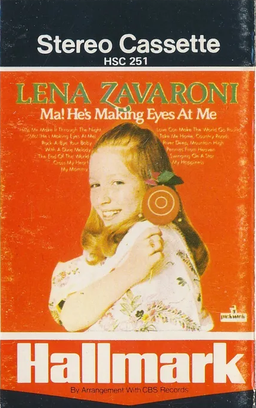

Ma! He's Making Eyes At Me is the debut album by Scottish singer Lena Zavaroni, released in 1974 on Philips Records.

<figure class="fig1">
<h2 id="infobx1"><a href="#infobx1">Album Cover and Details</a></h2>

<figcaption>
<table>
<tr><th colspan="2"></th></tr>
<tr><th>Label:</th><td>Hallmark – HSC 251</td></tr>
<tr><th>Format:</th><td>Cassette Tape</td></tr>
<tr><th>Country:</th><td>UK</td></tr>
<tr><th>Released:</th><td>1974</td></tr>
</table>
</figcaption>
</figure>

<figure class="fig2">
<h2 id="infobx2"><a href="#infobx2">Tracks</a></h2>
<figcaption>
<strong>A-Side</strong>
</figcaption>
<ol>
<li>Ma! (He's Making Eyes At Me)</li>
<li>The End Of The World</li>
<li>Swinging On A Star</li>
<li>Help Me Make It Through The Night</li>
<li>Cross My Heart</li>
<li>My Mammy</li>
</ol>
<figcaption>
<strong>B-Side</strong>
</figcaption>
<ol>
<li>Rock-A-Bye Your Baby With A Dixie Melody</li>
<li>Take Me Home, Country Roads</li>
<li>Pennies From Heaven</li>
<li>Love Can Make The World Go Round</li>
<li>My Happiness</li>
<li>River Deep, Mountain High</li>
</ol>
</figure>

 {: .clear}

