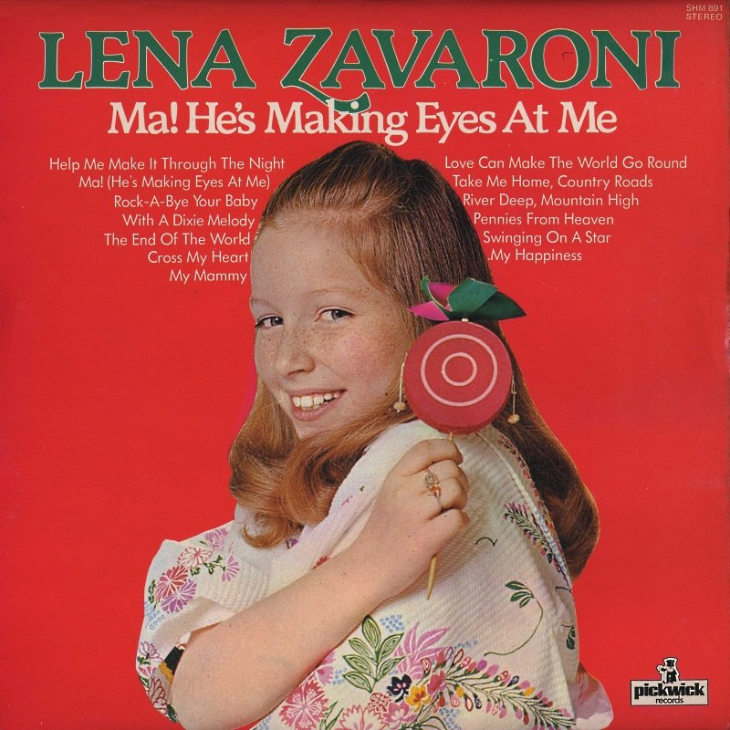

<figure class="fig1">
<h2 id="cover"><a href="#cover">Album Cover and Details</a></h2>

<figcaption>
<table>
<tr><th colspan="2"></th></tr>
<tr><th>Label:</th><td>Pickwick – SHM 891</td></tr>
<tr><th>Format:</th><td>12" Vinyl, 33⅓ Album</td></tr>
<tr><th>Country:</th><td>UK</td></tr>
<tr><th>Released:</th><td>1976</td></tr>
<tr class="split"><th>45worlds:</th><td><a class="external-link" href="http://www.45worlds.com/vinyl/album/shm891">shm891</a></td></tr>
</table>
</figcaption>
</figure>

<figure class="fig2">
<h2 id="tracks"><a href="#tracks">Tracks</a></h2>
<figcaption>
<strong>A-Side</strong>
</figcaption>
<ol>
<li>Ma! (He's Making Eyes At Me)</li>
<li>The End Of The World</li>
<li>Swinging On A Star</li>
<li>Help Me Make It Through The Night</li>
<li>Cross My Heart</li>
<li>My Mammy</li>
</ol>
<figcaption>
<strong>B-Side</strong>
</figcaption>
<ol>
<li>Rock-A-Bye Your Baby With A Dixie Melody</li>
<li>Take Me Home, Country Roads</li>
<li>Pennies From Heaven</li>
<li>Love Can Make The World Go Round</li>
<li>My Happiness</li>
<li>River Deep, Mountain High</li>
</ol>
</figure>

 {: .clear}

